Backend developer from Poland, focused on Python services and application security. Part-time CS engineering student at PJATK in Gdańsk.

### Now building
**[LLM Security Gateway](https://github.com/FilipSzzz/LLM_Security_Gateway)** 

An open-source FastAPI proxy that sits between an application and an LLM API. It rate-limits clients, rejects prompt-injection attempts and masks personal data in both directions, and runs locally with one `docker compose up`. Work in progress.

### Experience

### Stack

